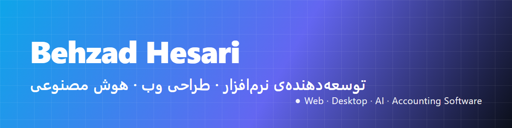

# Behzad Hesari
### Software Engineer · Web Design · Custom Software · AI Solutions & Training

**توسعه‌دهنده‌ی نرم‌افزار و طراح وب در ایران** — طراحی حرفه‌ای سایت، نرم‌افزار سفارشی، طراحی اپلیکیشن، نرم‌افزار حسابداری، آموزش برنامه‌نویسی و راه‌حل‌های هوش مصنوعی. 
*Freelance software engineer based in Iran, working with clients in Iran and worldwide.*

---

## 🎯 خدمات · Services

| خدمت · Service | توضیح · Description |
|---|---|
| **طراحی سایت حرفه‌ای** · Professional Website Design | وب‌سایت شرکتی، معرفی، نمونه‌کار، فروشگاهی و رزرو آنلاین؛ دوزبانه (فارسی راست‌به‌چپ و انگلیسی) و بهینه‌سازی سئو · Corporate, portfolio, e-commerce and booking websites, bilingual, SEO-ready |
| **نرم‌افزار سفارشی** · Custom Software | نرم‌افزار دسکتاپ ویندوز و سامانه‌های داخلی با Electron، React، Rust و Python · Desktop and internal business systems |
| **طراحی اپلیکیشن** · App Design | طراحی رابط کاربری و تجربه کاربری (UI/UX) و توسعه‌ی اپلیکیشن · UI/UX design and app development |
| **نرم‌افزار حسابداری** · Accounting Software | حسابداری شخصی، حسابداری طلا‌فروشی‌ها و مدیریت مالی کسب‌وکار · Personal and business accounting, gold-shop accounting |
| **هوش مصنوعی** · AI Solutions | اتوماسیون، ربات‌های هوشمند، بهینه‌سازی گردش کار با AI و یکپارچه‌سازی مدل‌های زبانی · Automation, intelligent bots, LLM integration |
| **آموزش** · Training | آموزش برنامه‌نویسی، توسعه‌ی وب و کار حرفه‌ای با هوش مصنوعی · Coding, web development and professional AI workflows |
| **قالب و افزونه‌ی وردپرس** · WordPress | توسعه‌ی قالب و افزونه از طراحی تا استقرار · Theme and plugin development |

---

## 🧩 محصولات و پروژه‌ها · Products & Projects

- 💰 **دخلینو · Dakhlino** — نرم‌افزار حسابداری شخصی برای مدیریت درآمد، هزینه و بودجه · *Personal finance and accounting app*
- 🪙 **حسابداری طلافروشی · Gold Shop Accounting** — مدیریت حسابداری و موجودی برای طلافروشی‌ها · *Accounting for gold and jewelry shops*
- 📝 **[Vesta Edge](https://github.com/BehzadHesari/vesta-edge)** — داک شناور و شیشه‌ای برای لبه‌ی صفحه ویندوز؛ کلیپ‌بورد با پیست با استایل، ایموجی، یادداشت و تقویم شمسی. رایگان و متن‌باز (MIT) · *Free open-source Windows side dock — styled clipboard, emoji, notes, Persian calendar*
- 🧱 **قالب وستا · Vesta WordPress Theme** — قالب و افزونه‌های وردپرس برای معرفی محصولات و دوره‌ها · *WordPress theme and plugins*
- 🌐 **وب‌سایت‌های سفارشی · Custom Websites** — وب‌سایت معرفی و نمونه‌کار با Next.js · *Portfolio and business websites with Next.js*

---

## 🛠️ تخصص‌ها · Skills

**Web:** React · Next.js · TypeScript · Tailwind CSS · Responsive & RTL design · SEO
**Desktop:** Electron · Vite · Rust · Windows desktop software · Installers (Inno Setup)
**Backend & Data:** Python · Django · Node.js · Prisma · SQLite · PostgreSQL
**AI:** LLM integration · AI automation · Telegram & AI bots · AI workflows for business
**CMS & Tools:** WordPress · Git & GitHub · Linux servers · PM2 · SSL & DNS

---

## 🤝 همکاری و سفارش پروژه · Work With Me

**برای مشتریان در ایران:** مشاوره‌ی رایگان اولیه، برآورد شفاف، و تحویل مرحله‌به‌مرحله. 
**For international clients:** Available for freelance and remote projects in English. Clear scope, transparent pricing and regular updates.

- 📩 ایمیل · Email: [behzad.hesari@gmail.com](mailto:behzad.hesari@gmail.com)
- 💬 تلگرام · Telegram: [@behzad3782](https://t.me/behzad3782)
- 📱 واتس‌اپ · WhatsApp: [w.me/behzad3782](https://w.me/behzad3782)
- 🌐 گروه فناوری اطلاعات وستا · Vesta IT Group: [vestait.ir](https://vestait.ir)

---

## 📊 آمار GitHub · GitHub Stats

---

**Keywords:** Software Engineer Iran · طراح وب ایران · طراحی سایت حرفه‌ای · نرم‌افزار حسابداری · حسابداری طلافروشی · برنامه‌نویس فریلنسر · AI automation · Freelance developer Iran · Hire a web developer · Custom desktop software · WordPress developer

© Behzad Hesari · Vesta IT Group · Made in Iran 🇮🇷

